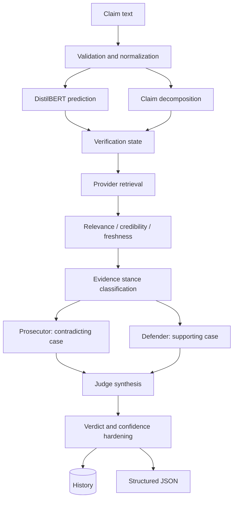

# AI Pipeline

## End-to-end flow

## Claim processing

The API validates a non-empty claim. `decompose_claim()` identifies domain and claim units. The graph state carries the original claim, model signal, search context, evidence, arguments, and judge output.

## ML signal

`ModelService` lazily loads `backend/models/genesis_distilbert`, selects CUDA when available, and returns label, confidence, class probabilities, and device. `_model_prediction()` makes model failure non-fatal. The signal is returned to the frontend and contributes context to downstream processing; the judge is not simply a direct neural classifier.

## Evidence and agents

The retriever normalizes provider results into evidence records. Filtering removes low-quality, duplicate, or self-referential sources. Credibility and ranking services score source/domain quality, freshness, specificity, and relevance. Prosecutor emphasizes contradicting evidence; defender emphasizes supporting evidence. The judge combines arguments and evidence, with deterministic known-fact and fallback logic active by default.

## LLM boundary

LLM agent calls are feature-gated. With defaults, deterministic functions handle analysis and debate. When enabled, `llm_client.py` routes reasoning through configured providers and extracts structured JSON where possible. Errors fall back rather than silently fabricating missing evidence.

## Output

The final response includes verdict, confidence, explanation/reasoning, evidence, evidence summary, model prediction, pipeline stages, and agent analyses. Authenticated requests additionally persist a complete details snapshot.
