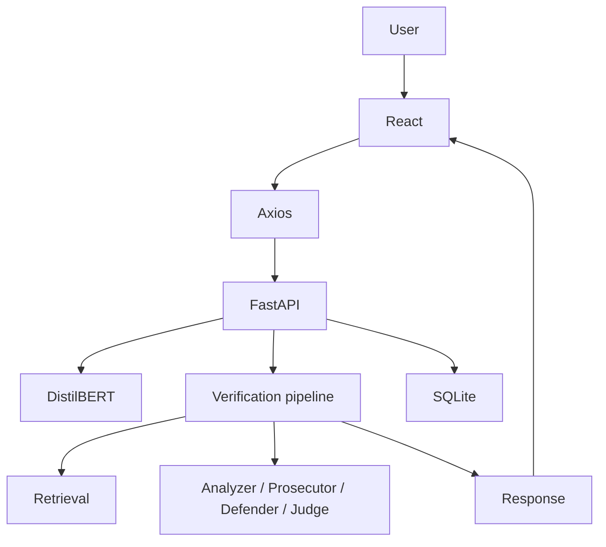
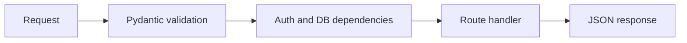
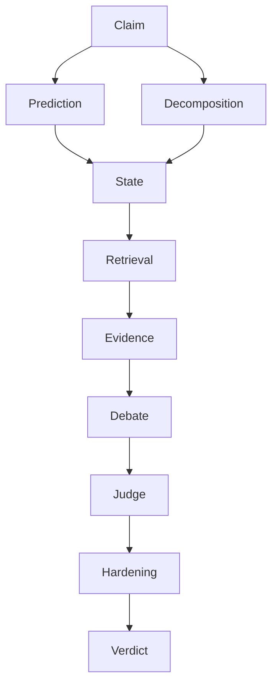
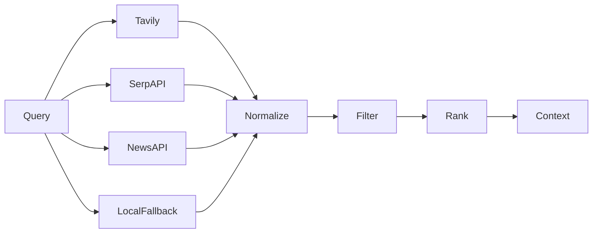
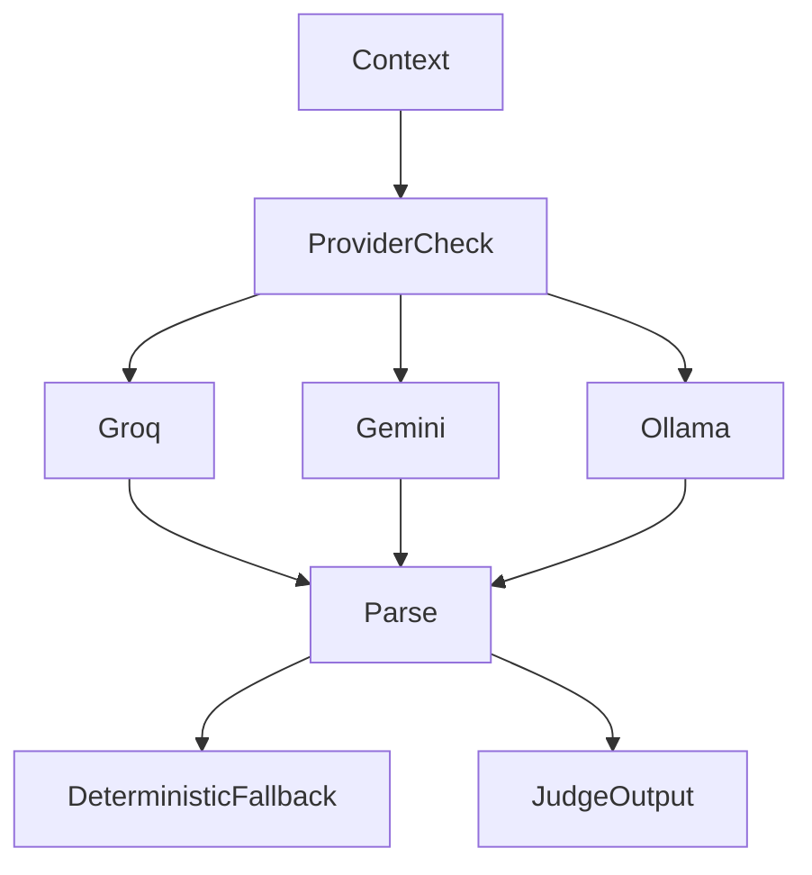
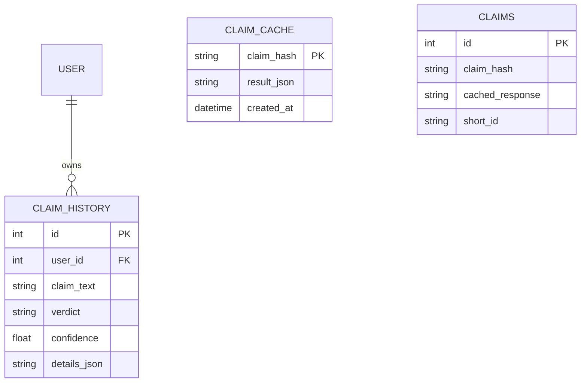
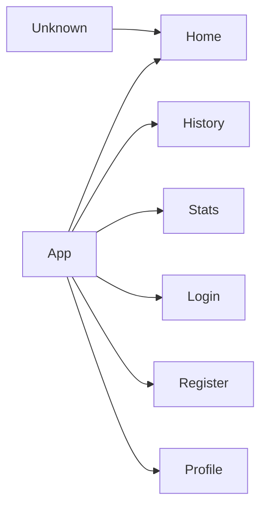
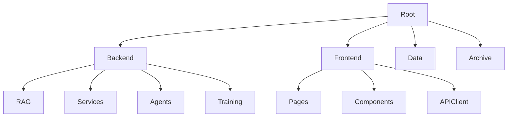
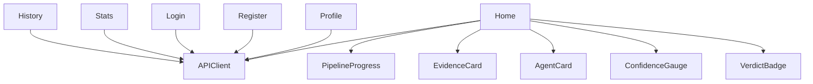

# Flowcharts

## Overall architecture

## API flow

## Verification pipeline

## Evidence retrieval

## LLM reasoning

## Database interactions

## Frontend navigation

## Folder hierarchy

## Component dependency graph

