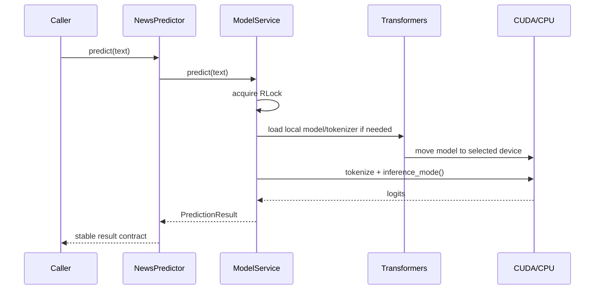

# Genesis ML Inference Architecture

This document describes the framework-agnostic inference layer for the
DistilBERT fake-news classifier. It is intentionally independent of FastAPI
and the frontend.

## Components

```text
backend/
├── models/
│   └── genesis_distilbert/       # Training output: weights, config, tokenizer
├── inference/
│   ├── __init__.py               # Public inference exports
│   └── predictor.py              # Stable NewsPredictor interface
└── services/
    └── model_service.py          # Lazy, thread-safe model lifecycle
```

### `backend/models/`

The trained artifact is expected at
`backend/models/genesis_distilbert/`. Training writes the DistilBERT weights,
`config.json`, tokenizer files, metrics, and history there. The inference
service loads only local files, preventing an inference request from silently
downloading a model.

### `backend/inference/predictor.py`

`NewsPredictor` is the application-facing contract:

```python
from backend.inference import NewsPredictor

result = NewsPredictor().predict_article(title, body)
print(result.as_dict())
```

`PredictionResult` contains:

- `label`: `REAL` or `FAKE` according to the saved model configuration
- `confidence`: probability of the selected label
- `probabilities`: probabilities for both labels
- `device`: `cuda` or `cpu`

### `backend/services/model_service.py`

`ModelService` owns tokenizer/model loading and inference. It provides:

- **Lazy loading:** importing the service does not load model weights.
- **GPU/CPU fallback:** CUDA is selected when `torch.cuda.is_available()`;
  otherwise CPU is used.
- **Thread-safe singleton:** `get_model_service()` protects singleton creation
  with an `RLock`, while the service lock prevents duplicate initialization.
- **Local-only loading:** `local_files_only=True` avoids network access during
  inference.
- **Explicit errors:** missing/incomplete artifacts raise
  `ModelNotFoundError`; loading failures raise `ModelLoadError`; invalid input
  or inference failures raise `PredictionError`.

## Request flow



## Lifecycle and operational rules

1. Training must finish writing `backend/models/genesis_distilbert/` before
   inference is enabled.
2. The first prediction incurs model-load latency; later predictions reuse the
   in-memory model.
3. If the model is missing, callers receive a typed error rather than a
   fabricated fallback prediction.
4. `GENESIS_MODEL_PATH` can override the default artifact path, and
   `GENESIS_MAX_LENGTH` can override the tokenizer sequence length.
5. FastAPI integration should be added later as a thin adapter around
   `NewsPredictor`; it should not duplicate model loading or inference logic.
