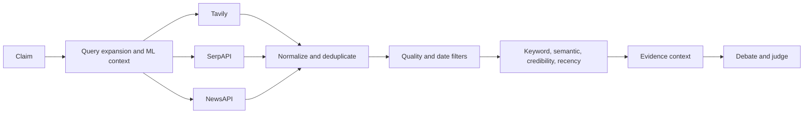

# RAG Pipeline

## Retrieval path

The active retriever is `backend/rag/retriever.py`. It supports Tavily, SerpAPI, NewsAPI, and a local `backend/data/news_articles.json` fallback. Provider order and fallback behavior are implemented in code; unavailable providers do not necessarily abort the request.

## Embeddings and vector search

`rag/embeddings.py` exposes an `EmbeddingModelSingleton` using SentenceTransformers `all-MiniLM-L6-v2`, with a hash-based fallback if the model is unavailable. `rag/faiss_store.py` provides an in-memory FAISS abstraction. `GENESIS_USE_ADVANCED_RAG` defaults to `0`, so the minimal path is selected by default and the advanced FAISS path is not assumed active.

## Chunking and context

The active code primarily works with normalized article/result records rather than a persistent document store. Raw content may be extracted by provider clients, then truncated/normalized for scoring and prompt context. The project does not establish a durable FAISS index in the active minimal path.

## Safety

Retrieved text is evidence, not instructions. Provider content must be treated as untrusted input. The system should continue to separate claim, source metadata, and evidence text when prompt templates are changed.

## Caching

Retriever API caching is implemented but disabled by default through configuration. Backend advanced claim caching is disabled in `main.py`; frontend result caching remains active.
