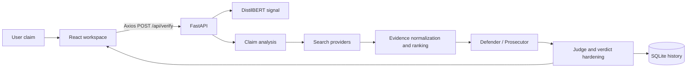

# Genesis

[](https://www.python.org/)
[](https://fastapi.tiangolo.com/)
[](https://react.dev/)
[](https://pytorch.org/)
[](LICENSE)

**Genesis is an evidence-oriented claim verification platform.** It combines a FastAPI service, a React investigation workspace, a locally hosted DistilBERT classifier, live search providers, retrieval/ranking utilities, deterministic debate agents, optional LLM reasoning, and SQLite persistence.

> Genesis is a research and engineering project—not a substitute for professional fact-checking. Search coverage, provider availability, model limitations, and hard-coded known-fact rules can affect results.

## Contents

- [Why Genesis exists](#why-genesis-exists)
- [Features](#features)
- [How it works](#how-it-works)
- [Technology](#technology)
- [Repository structure](#repository-structure)
- [Run locally](#run-locally)
- [Configuration](#configuration)
- [API quick reference](#api-quick-reference)
- [Documentation map](#documentation-map)
- [Screenshots](#screenshots)
- [Roadmap](#roadmap)
- [Contributing](#contributing)
- [License and acknowledgements](#license-and-acknowledgements)

## Why Genesis exists

False or misleading claims move faster than careful verification. Genesis makes the verification process inspectable: users submit a claim, the system gathers evidence, ranks sources, compares supporting and contradicting signals, and returns a verdict with confidence, reasoning, and source context.

## Features

- Claim verification through `POST /api/verify`.
- DistilBERT inference with CUDA-or-CPU selection and class probabilities.
- WELFake-based training code with train/validation/test splits, early stopping, metrics, and model export.
- Tavily, SerpAPI, NewsAPI, and local-dataset retrieval paths.
- Evidence filtering, deduplication, credibility, freshness, and relevance scoring.
- Prosecutor, defender, and judge stages with deterministic defaults and optional LLM agents.
- JWT authentication and SQLite-backed users, claim history, and cache records.
- History, statistics, sharing, and PDF export endpoints.
- React workspace with verification timeline, evidence cards, confidence, model signal, agent reasoning, history, and authentication views.
- CORS configuration for local Vite development.

## How it works



The active default is deliberately conservative: minimal retrieval and deterministic agent logic are enabled unless feature flags turn on advanced paths. Read [AI_PIPELINE.md](AI_PIPELINE.md) and [CONFIGURATION_GUIDE.md](CONFIGURATION_GUIDE.md) before changing those defaults.

## Technology

| Area | Technologies |
|---|---|
| Backend | Python, FastAPI, Uvicorn, SQLAlchemy, Pydantic |
| ML | PyTorch, Hugging Face Transformers, DistilBERT, WELFake |
| Retrieval | Tavily, SerpAPI, NewsAPI, Requests, BeautifulSoup, SentenceTransformers, FAISS abstraction |
| Reasoning | Groq, Gemini, Ollama; LangGraph-compatible orchestration |
| Storage | SQLite, SQLAlchemy ORM, JSON snapshots |
| Frontend | React 19, React Router, Axios, Vite, Framer Motion, Chart.js, Lucide |
| Reports | ReportLab |

## Repository structure

```text
Genesis/
├── backend/
│   ├── main.py                 # FastAPI app, routes, orchestration, response shaping
│   ├── agents.py               # Verification graph and agent nodes
│   ├── agents/                 # Analyzer, prosecutor, defender, judge
│   ├── auth.py                 # Password hashing and JWT dependencies
│   ├── database.py             # SQLAlchemy models and SQLite helpers
│   ├── rag/                    # Retrieval, providers, embeddings, FAISS abstraction
│   ├── services/               # Model, ranking, credibility, cache, metrics services
│   ├── training/               # WELFake/DistilBERT training and evaluation
│   ├── inference/              # Older standalone predictor interface
│   └── models/genesis_distilbert/ # Trained model artifact
├── frontend/react-app/
│   ├── src/App.jsx             # Router and session shell
│   ├── src/pages/              # Home, history, stats, auth, profile
│   ├── src/components/         # Evidence, verdict, gauge, progress, agent cards
│   └── src/services/api.js     # Axios API client
├── data/                       # WELFake dataset copy
├── archive/                    # Superseded implementations and deployment files
└── *.md                        # Architecture and engineering documentation
```

## Run locally

### Prerequisites

- Python 3.11+
- Node.js and npm
- Optional: CUDA-enabled PyTorch installation
- Optional provider credentials for live search and LLM reasoning

### Backend

```powershell
python -m venv .venv
.\.venv\Scripts\Activate.ps1
pip install -r backend\requirements.txt
python -m uvicorn backend.main:app --reload --port 8000
```

### Frontend

```powershell
Set-Location frontend\react-app
npm install
npm run dev
```

The Vite app normally runs on port 5173 or 5174. Set `VITE_API_BASE_URL=http://localhost:8000` in `frontend/react-app/.env` when the frontend and backend run separately.

### Verify the installation

```powershell
Invoke-WebRequest http://localhost:8000/api/health
Invoke-WebRequest http://localhost:8000/openapi.json
```

## Configuration

Copy the examples before adding local values:

```powershell
Copy-Item backend\.env.example backend\.env
Copy-Item frontend\react-app\.env.example frontend\react-app\.env
```

Never commit real credentials. The backend loads its local environment from `backend/.env`; the frontend exposes only Vite-prefixed browser configuration. See [CONFIGURATION_GUIDE.md](CONFIGURATION_GUIDE.md) for every discovered variable, default, and consumer.

## API quick reference

| Method | Path | Purpose |
|---|---|---|
| POST | `/api/verify` | Full claim verification |
| POST | `/api/model/predict` | Standalone DistilBERT prediction |
| POST | `/api/verify/batch` | Verify up to five claims |
| GET | `/api/claims/history` | History list |
| GET | `/api/claims/history/{history_id}` | History detail |
| GET/HEAD | `/api/export/pdf/{verification_id}` | PDF export |
| GET | `/api/stats` | Verification statistics |
| GET | `/api/trending` | Recent trending claims |
| GET | `/api/health` | Provider readiness |
| POST | `/api/auth/register` | Register |
| POST | `/api/auth/login` | Login |
| GET | `/api/auth/me` | Current user |

The complete route-by-route reference is in [API_DOCUMENTATION.md](API_DOCUMENTATION.md).

## Documentation map

- [PROJECT_OVERVIEW.md](PROJECT_OVERVIEW.md) — purpose, users, and principles
- [SYSTEM_ARCHITECTURE.md](SYSTEM_ARCHITECTURE.md) — architecture and dependency diagrams
- [EXECUTION_FLOW.md](EXECUTION_FLOW.md) — click-to-response lifecycle
- [API_DOCUMENTATION.md](API_DOCUMENTATION.md) — all active endpoints
- [COMPONENT_BREAKDOWN.md](COMPONENT_BREAKDOWN.md) — important files and symbols
- [DATABASE_AND_STORAGE.md](DATABASE_AND_STORAGE.md) — schema and persistence
- [AI_PIPELINE.md](AI_PIPELINE.md) — end-to-end verification reasoning
- [MACHINE_LEARNING.md](MACHINE_LEARNING.md) — DistilBERT training and inference
- [RAG_PIPELINE.md](RAG_PIPELINE.md) — retrieval and ranking
- [LLM_INTEGRATION.md](LLM_INTEGRATION.md) — provider routing and prompts
- [FRONTEND_ARCHITECTURE.md](FRONTEND_ARCHITECTURE.md) — React structure and state
- [BACKEND_ARCHITECTURE.md](BACKEND_ARCHITECTURE.md) — FastAPI internals
- [FILE_SUMMARY.md](FILE_SUMMARY.md) — important-file inventory
- [CODE_FLOW.md](CODE_FLOW.md) — sequence diagrams
- [DEPENDENCY_ANALYSIS.md](DEPENDENCY_ANALYSIS.md) — dependency rationale
- [CONFIGURATION_GUIDE.md](CONFIGURATION_GUIDE.md) — environment reference
- [LEARNING_GUIDE.md](LEARNING_GUIDE.md) — beginner-friendly introduction
- [IMPROVEMENT_REPORT.md](IMPROVEMENT_REPORT.md) — honest technical critique
- [FLOWCHARTS.md](FLOWCHARTS.md) — consolidated Mermaid diagrams

## Screenshots

Add repository-managed screenshots here when the UI is stable:

```text
/docs/screenshots/home.png
/docs/screenshots/history.png
/docs/screenshots/evidence-detail.png
```

## Roadmap

1. Stabilize authentication dependency versions and add automated auth tests.
2. Add contract tests shared by Axios and FastAPI.
3. Make database paths explicit and environment-independent.
4. Decide whether advanced FAISS/Neo4j paths remain supported or should be removed.
5. Add provider mocks and deterministic end-to-end fixtures.
6. Improve source ownership checks for history, sharing, and PDF routes.
7. Add deployment configuration that matches the active application.

## Contributing

Keep active code under `backend/` and `frontend/react-app/`. Treat `archive/` as historical unless a task explicitly targets it. For changes that affect API responses, update the API documentation and add a focused test or reproducible verification command. Do not commit `.env` files, model secrets, database dumps, or generated credentials.

## License and acknowledgements

The repository does not currently declare a canonical license file; add one before publishing as an open-source project. Genesis builds on FastAPI, React, PyTorch, Hugging Face Transformers, SentenceTransformers, FAISS, LangGraph, ReportLab, and the respective search/LLM provider SDKs.

## Repository Audit Summary

- **Folders analyzed:** 47 excluding dependency/build caches
- **Python files:** 36 under `backend/`
- **React/JS/TS source files:** 16 under `frontend/react-app/src/`
- **API route decorators:** 21 in `backend/main.py`
- **Database tables:** 4 active SQLite tables (`users`, `claim_history`, `claim_cache`, compatibility `claims`)
- **AI components:** DistilBERT model service, training/evaluation modules, claim analyzer, retrieval, embeddings, prosecutor, defender, judge, LLM client
- **Services:** cache, credibility, evidence classifier, metrics, model, ranking
- **Utilities:** authentication, filters, PDF export, retrieval clients, state/graph compatibility layers
- **Environment variables:** 35 documented or discovered across backend/frontend examples
- **Technologies detected:** Python, FastAPI, Uvicorn, SQLAlchemy, SQLite, PyTorch, Transformers, React, Vite, Axios, SentenceTransformers, FAISS, LangGraph, Groq, Gemini, Ollama, Tavily, SerpAPI, NewsAPI, ReportLab
- **Overall summary:** A modular full-stack verification application whose active path is FastAPI → local classifier → retrieval → deterministic debate/judge → SQLite/JSON response → React investigation workspace, with optional provider-backed LLM and advanced retrieval features.
