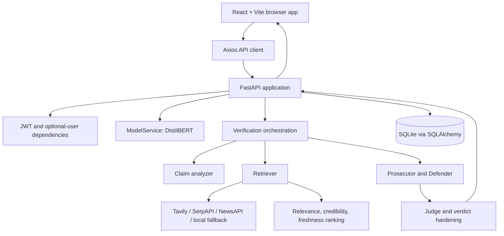
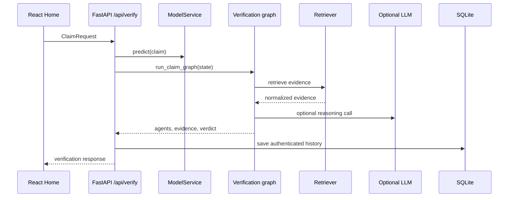
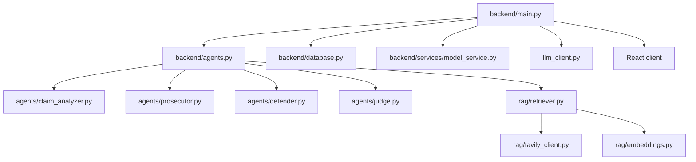

# System Architecture

## High-level architecture

## Layer architecture

| Layer | Active modules | Responsibility |
|---|---|---|
| Presentation | `frontend/react-app/src` | Routes, forms, result rendering, local UI state |
| Transport | `frontend/.../services/api.js`, FastAPI routes | HTTP requests and response contracts |
| Application | `backend/main.py`, `backend/agents.py` | Request lifecycle and pipeline orchestration |
| Domain | `backend/agents/`, `backend/services/` | Claim analysis, evidence stance, scoring, judgment |
| Infrastructure | `backend/rag/`, `backend/llm_client.py`, `backend/database.py` | Providers, model loading, storage |
| Training | `backend/training/` | WELFake preprocessing and DistilBERT fine-tuning |

## Component interaction

## Dependency graph

`archive/` is historical and is not part of the default runtime path.
